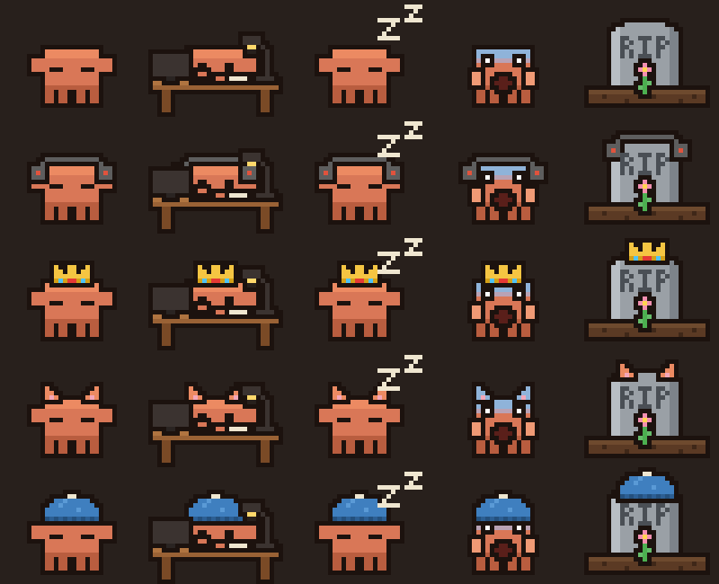

# Claude Pixel Pet

A tiny pixel-art pet that sits on your Windows desktop and reacts to how you use Claude Code. Written in Rust: one small `.exe`, about 13 MB of memory while running.



| Mood | When |
|---|---|
| **Working**: typing at a desk | Claude Code was active in the last 90 seconds |
| **Idle**: blinks now and then | Claude is open but quiet, or Claude is closed |
| **Sleeping**: Zz | Every Claude window is minimized, or nothing happened for 10 minutes |
| **Scream** 😱 | You've used 80% of your 5-hour limit |
| **RIP**: tombstone with a flower | You've used 100% of your weekly limit |

Dress it up with a skin: **headphones**, a **crown**, **cat ears** or a **beanie** (or none). The skin shows in every mood, even on the tombstone.

> Unofficial fan project. Not made by or affiliated with Anthropic.

## Run it

Windows only. If you have [Node.js](https://nodejs.org), one command puts the pet on your desktop ([npm package](https://www.npmjs.com/package/claude-pixel-pet)):

```
npx claude-pixel-pet
```

Running it again while the pet is already out does nothing, so you never get two. npx keeps the copy it downloaded; to get the newest version, run `npx claude-pixel-pet@latest`.

### Using it

- Drag it with the left mouse button.
- Right-click it to see your usage and where the numbers come from, preview any mood, or quit.
- Right-click → **Skin** to pick a skin. It's remembered next time (saved in `~/.claude/pet_settings.json`).

### Build from source

Install [Rust](https://rustup.rs), then build and start it:

```
git clone https://github.com/giannisBFMV/claude-pixel-pet.git
cd claude-pixel-pet
cargo build --release
target\release\pixel_pet.exe
```

Either Rust toolchain works. MSVC (the default) also needs the Windows SDK from the Visual Studio Installer. GNU needs nothing else: `rustup toolchain install stable-x86_64-pc-windows-gnu`, then `rustup override set stable-x86_64-pc-windows-gnu` in the project folder.

The built `pixel_pet.exe` runs on its own; you can copy it anywhere.

- Self-test: `cargo test` (add `-- --nocapture` to also print what the pet currently sees)
- Regenerate the animated preview: `target\release\pixel_pet.exe --preview` writes `pet_preview.gif` (every mood in every skin) to the current folder

## Where the limits come from

**Real limits (recommended).** If you use a Claude Code [status line](https://docs.claude.com/en/docs/claude-code/statusline), add this line to your status line script right after it reads its input. It saves the 5-hour and weekly percentages Claude sends to the status line, and the pet reads that file.

PowerShell (`$data` is the parsed input JSON):

```powershell
if ($data.rate_limits) { try { $data.rate_limits | ConvertTo-Json -Depth 5 | Set-Content -Encoding utf8 "$HOME/.claude/pet_limits.json" } catch {} }
```

Bash (`$input` is the raw input JSON, needs `jq`):

```bash
echo "$input" | jq -c '.rate_limits // empty' > ~/.claude/pet_limits.json.tmp && [ -s ~/.claude/pet_limits.json.tmp ] && mv ~/.claude/pet_limits.json.tmp ~/.claude/pet_limits.json
```

The numbers refresh whenever the status line runs (Claude Code in a terminal). Right-click the pet: it says `source: Claude`.

**Fallback estimate.** Without that file, the pet adds up the tokens in your Claude Code logs over a rolling 5 hours and 7 days and compares them to `FIVE_H_LIMIT` and `WEEK_LIMIT` at the top of `src/main.rs`. Tune those to your plan, then rebuild with `cargo build --release`.

## Privacy

The pet only reads local files: Claude Code's logs in `~/.claude/projects` and `~/.claude/pet_limits.json`. The only file it writes is `~/.claude/pet_settings.json`, your skin choice. It sends nothing anywhere.

## Limitations

- Windows only (window detection and the see-through window use Windows APIs).
- Detects the Claude desktop app and the native `claude.exe` CLI; an npm-installed CLI (`node.exe`) isn't detected as an open window.
- Doesn't start with Windows by itself. To do that, put a shortcut to `pixel_pet.exe` (or a `.cmd` file containing `npx claude-pixel-pet`) in your Startup folder (`Win+R` → `shell:startup`).

## Publishing a new version (maintainers)

Bump `version` in `package.json` (and `Cargo.toml`), then run `npm publish`. It runs `cargo build --release` first and ships the fresh `pixel_pet.exe` inside the package. npm asks you to confirm with two-factor authentication in the browser, and the new version can take a few minutes to appear.

## License

MIT
